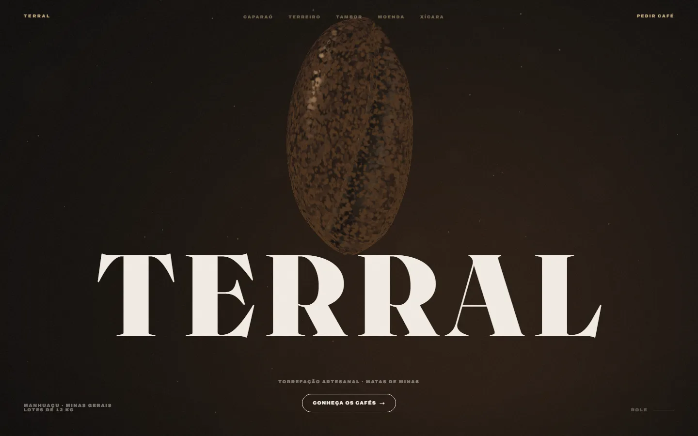
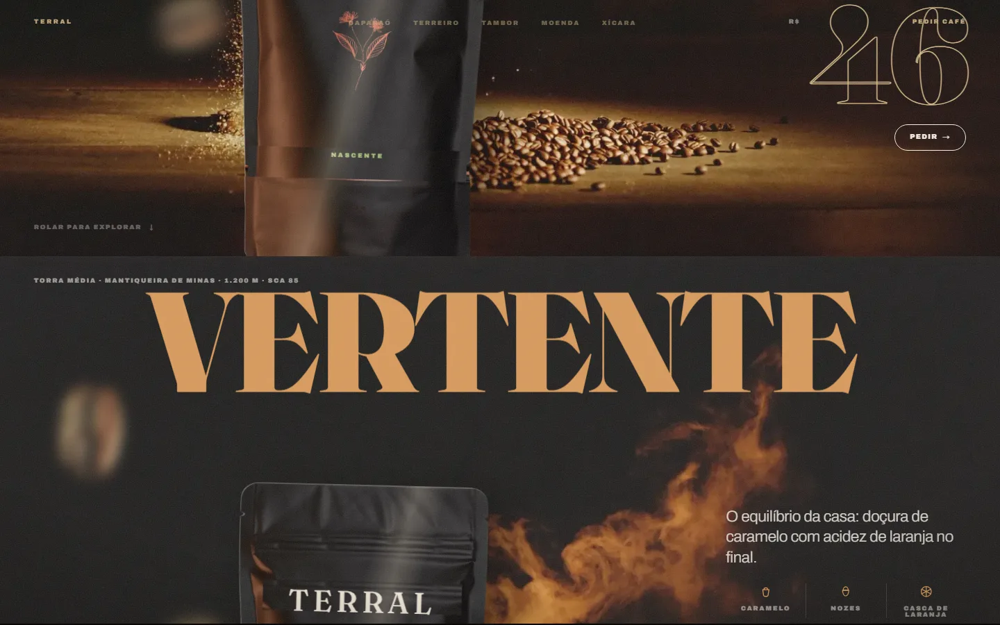

# TERRAL — da montanha à xícara

[Português](README.pt-BR.md) · [English](README.md)

Experiência web guiada pela rolagem sobre o universo do café especial, criada como projeto conceitual de portfólio da [MilWeb](https://milweb.com.br). TERRAL é uma **marca fictícia**: torrefação, endereço, produtos, preços e números exibidos no site são ilustrativos.

> **Tipo:** conceito (portfólio) · **Demo:** [terral-cafe.vercel.app](https://terral-cafe.vercel.app)



## O que o site faz

- **Hero com grão de café em 3D** renderizado em tempo real com Three.js / React Three Fiber (geometria procedural e shaders próprios), com tela de carregamento.
- **Cinco capítulos** — Caparaó, Terreiro, Tambor, Moenda e Xícara — cada um em um painel horizontal fixado e conduzido pela rolagem (GSAP ScrollTrigger + Lenis), com cor própria, indicadores, fotos e um vídeo curto em loop.
- **Vitrine de cafés** com três blends ilustrativos (Nascente, Vertente, Vulcânico) e um clube de assinatura; os botões de pedido abrem uma mensagem pronta no WhatsApp.
- **Página escondida** (`/casa-do-torrador`): segurar o botão do rodapé por seis segundos a desbloqueia; ela não é indexada.
- Página 404 própria, botões magnéticos e layout dedicado para celular.



## Stack

- Next.js 16.3 (App Router), React 19.2 e TypeScript
- Tailwind CSS 4
- GSAP (+ ScrollTrigger, `@gsap/react`) e Lenis
- Three.js, React Three Fiber e drei

As versões exatas estão em [package.json](package.json).

## Rodar localmente

Requisitos: Node.js 20.9+ (o CI usa Node 22) e pnpm 10.

```bash
git clone https://github.com/rickjs2005/terral.git
cd terral
pnpm install --frozen-lockfile
pnpm dev
```

Abra http://localhost:3000. Nenhuma variável de ambiente é necessária.

| Comando | Uso |
|---|---|
| `pnpm dev` | Servidor de desenvolvimento |
| `pnpm build` | Build de produção |
| `pnpm start` | Servir o build de produção |
| `pnpm lint` | ESLint |

## Estrutura

- `src/app/` — página inicial, `/casa-do-torrador`, 404 e layout raiz (fontes, metadados).
- `src/components/` — navegação, hero e cena 3D, intro/manifesto, capítulos, cafés e rodapé.
- `src/lib/chapters.ts` — textos, cores, indicadores e caminhos de mídia dos cinco capítulos.
- `src/lib/` — geometria do grão e utilitários de rolagem e animação.
- `public/shot/` — fotos, recortes e vídeos dos capítulos; `public/products/` — imagens dos produtos.
- `docs/screenshots/` — imagens usadas neste README.

## Limitações

- Site conceitual: não há checkout, backend nem estoque real. Os botões de WhatsApp apontam para o número comercial da MilWeb, não para uma torrefação real.
- O conteúdo está apenas em português.
- Não há testes automatizados; o CI roda lint e o build de produção.

## Créditos de mídia

- As fotos dos pacotes foram geradas com ferramenta de imagem por IA (Higgsfield), segundo o histórico de commits do projeto.
- A origem das fotos, recortes e vídeos dos capítulos em `public/shot/` não está documentada.
- `public/draco/` guarda uma cópia do decodificador Google Draco (terceiros) e `public/model/bean.glb` um modelo 3D; nenhum dos dois é carregado pelo código atual, já que o grão do hero é gerado proceduralmente.

## Segurança

Veja [SECURITY.md](SECURITY.md) para saber como reportar uma vulnerabilidade.

## Licença

Ainda não há licença definida; todos os direitos reservados ao autor.
